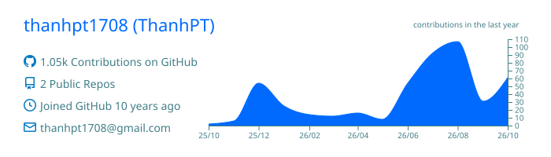
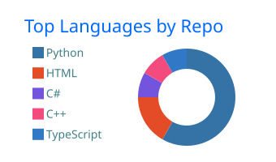
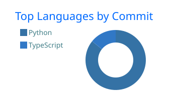
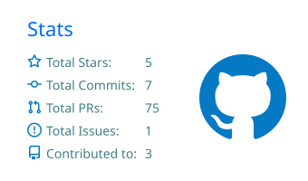
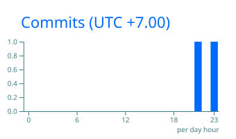

<!-- Header -->

  

  

  

---

## 🧑‍💻 About me

- 🐍 I build **backend services and data pipelines** with Python, FastAPI and Celery.
- 🤖 Lately I'm deep into **AI agents** — agent UIs, monitoring agents and **MCP servers**.
- ☸️ I run things on **Kubernetes** with GitOps (**Argo CD**) and **Jenkins** / GitHub Actions pipelines.
- 🏠 Off the clock: **Home Assistant** automations for my smart home.
- 💬 Ask me about: FastAPI architecture, async task queues, k8s deployments, LLM tooling.

## 🛠️ Tech stack

   
  

## 🚀 What I focus on

| | Area | Focus |
|:-:|---|---|
| 🤖 | **AI Agents** | Autonomous agents, MCP tool integrations, agent UIs |
| ⚙️ | **Backend** | Scalable APIs, async task queues, data crawling pipelines |
| ☸️ | **Platform** | Kubernetes, GitOps, CI/CD automation |
| 🛡️ | **Security** | Threat intelligence, DevSecOps |

## 📊 GitHub stats

<!-- Generated daily by .github/workflows/summary-cards.yml -->

  

  
  

  
  

  

<!-- Footer -->

  

